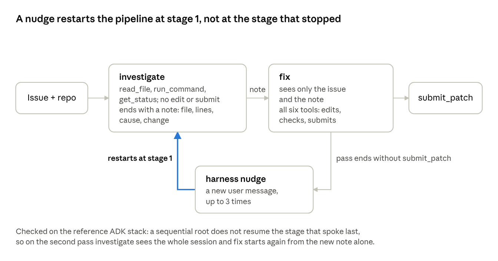
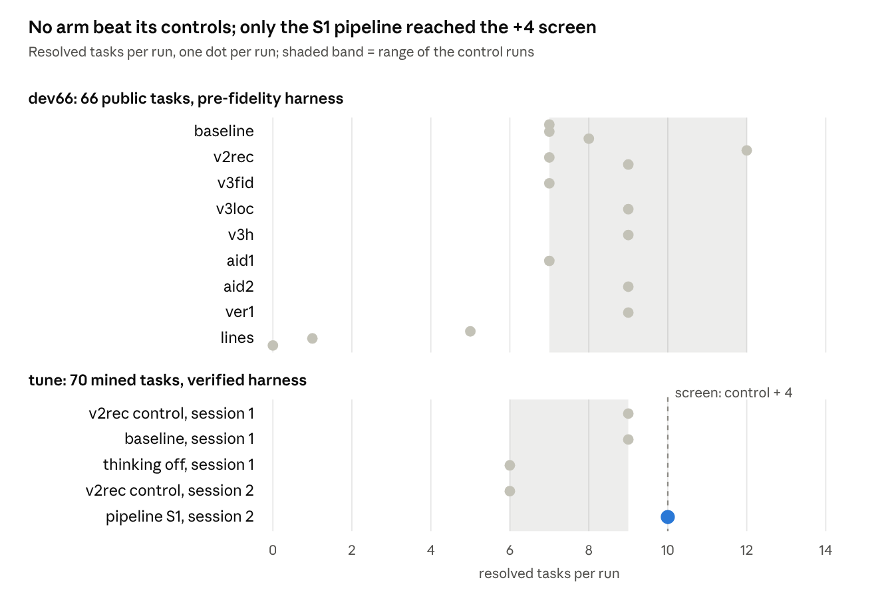
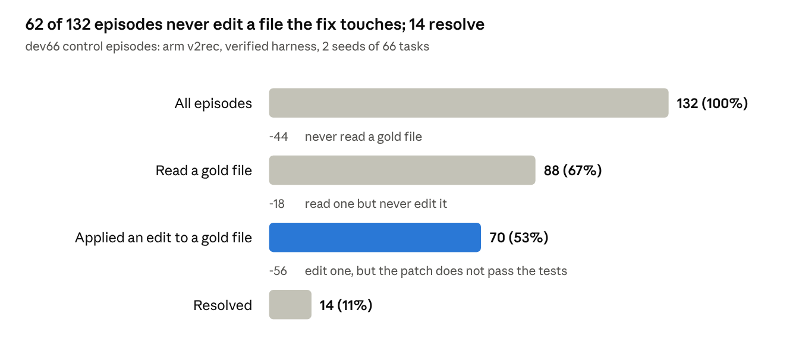

# Where a 4B Coding Agent Fails: A Fidelity-Checked Anatomy of Gemma 4 E4B on Real Repository Issues

*Edit copy errors, unseen files, and three fine-tuning routes that learned their targets and broke the agent*

**Ujjwal Raghav, Atharv Sharma** (jetha ke jabaaz) · November 2026

## Abstract

Small open models are the cheapest route to coding agents that run offline, but what limits them on real issues is unclear. We study Gemma 4 E4B as a single agent in a fixed-budget tool harness (six tools, 24 calls, 5.5 minutes per task). On a held-out set of 58 tasks from private repositories it resolves 2.

We first verified our local harness against the reference implementation's code: request bodies match byte for byte. Across 342 episodes, on public tasks and on 70 tasks mined from eight other repositories, 47% of episodes never edit a file the reference fix touches, and none of those resolves. Multi-file fixes resolve 0 of 42, and 60% of edit calls fail.

Failed edits are copy errors on visible text (93% of not-found anchors appear in the prompt), not JSON-escaping errors (3%). Only 19 of 103 locatable failed edits aim near the real fix, so perfect edit recovery is worth at most about 2 tasks in 66.

Three LoRA routes, including SFT on 1,606 replayed teacher trajectories from 888 repositories, learned their targets but shifted the agent's mix of steps. Two collapsed in agent runs, and an offline gate stopped the third. Twelve prompt and tool arms stayed inside run-to-run noise, which we measure. We describe the harness port, the gates and a screening protocol.

## 1. Introduction

A coding agent that runs on one consumer GPU needs a small model, and small models are where agents fail most. We study a declarative setting: an agent receives a GitHub issue and a repository snapshot, edits files through six fixed tools under a hard budget, and is graded by hidden tests on tasks from private repositories.

Our two held-out E4B runs resolve 2 and 1 of 58 tasks. When one task is worth 1.7 points, such results cannot rank configurations, so we ask instead: what limits a 4B model in this loop, and which interventions can move it at all?

That needs an instrument we can trust. Local proxies overstate the held-out result 3-4x for this model, runs vary by several tasks, and our first harness differed from the reference harness in what the model sees. The paper contributes:

1. **A verified local evaluator:** the reference agent loop, prompt builder and edit matcher, checked byte for byte against the reference packages for single agents and two-stage trees, plus harness behaviours that change agent design.
2. **A failure anatomy** of 342 episodes, with an aim check that bounds what any edit-recovery method can gain.
3. **Three negative training results** and the offline gates that predicted them.
4. **A measured noise budget** and the screening rule that follows from it.

## 2. Setting

**Harness.** The agent is a Google ADK tree declared in YAML, with six fixed tools: `read_file` (150 lines or 10,000 characters), `edit_file` (`old_string` must match once, through exact, whitespace-flexible, regex or JSON-unescaped matching), `write_file`, `run_command` (90 s, 5,000 characters of output), `get_status` and `submit_patch`. We allow 24 calls, 5.5 minutes and 40 turns per task. Held-out evaluation allows 12 hours for about 120 tasks. Context is summarised past 14,336 tokens, and a pass that ends without `submit_patch` is nudged up to three times. The agent designer controls prompts, sampling, thinking, the agent tree, skills and a LoRA adapter per agent.

**Model.** `gemma-4-e4b-it` (QAT W4A16), thinking on with a 4,096-token budget. The main arm `v2rec` pairs an edit-hygiene prompt with the checkpoint's sampling (temperature 1.0, top-p 0.95, top-k 64); the baseline is our earlier prompt for the 31B model at temperature 0.2. We serve vLLM 0.32.0 on one Colab GPU and grade with our Docker-free grader, network off.

**Fidelity.** Our first harness, reimplemented from the README, differed from the reference packages (swegemma 0.2.11, adk-submission 0.2.13, google-adk 1.36.1) in eight places, among them the first prompt, the matcher tiers, the thinking switch and thought replay. We ported each piece and drove the reference modules against a mock model server. Request bodies match byte for byte for a single agent (one local-only field aside) and in six two-stage scenarios, and 8,000 seeded cases (about 40,000 comparisons) show 0 mismatches. On a real server, the token ids vLLM received equal our offline render. Numbers come from the verified harness unless marked *pre-fidelity*.

**Task pools.** Mined tasks come from merged PRs that close an issue (1-3 source files, 2-80 changed lines, new tests) and are kept only if the gold patch resolves and the empty patch does not. Repositories were split by a fixed hash before any result existed.

| Pool | Tasks | Repositories | Use |
| --- | --- | --- | --- |
| dev66 (public) | 66 | fastapi 60, requests 5, httpx 1 | Diagnosis; traces read in full |
| tune (mined) | 70 | click 15, packaging 15, falcon 12, werkzeug 10, tornado 10, loguru 4, black 2, pygments 2 | Screening; may be read |
| unseen (mined) | 52 | pydantic-settings, isort, urllib3, marshmallow, litestar, scrapy | Milestones only; aggregates only |
| held-out (hosted) | 58 | private | Final evaluation only; one run per day |

**Protocol.** Every arm has a pass rule written before it runs and is compared with a control rerun in the same session. A screening pass needs +4 tasks and buys two more seeds, never a claim.

## 3. Interventions

**Prompt, sampling and tool arms** (dev66, *pre-fidelity*): `v2rec`; short, clean edit anchors (`v3fid`); ranking files by distinctive words (`v3loc`); budget and exact-name rules (`v3h`); a line-range edit skill (`lines`); a BM25 file finder plus a forgiving edit retry (`aid1`, `aid2`); and reproduce, edit, recheck (`ver1`). On the tune pool we added thinking off (`th0`).

**Edit-only LoRA (`edit_v1`).** Rank 32, alpha 64, one epoch on 4,000 single-step `edit_file` samples from tune-repository commits and gold patches; training loss 0.834 to 0.374. Served at scale 2.0, then at 0.5.

**Self-distillation probe.** SDPO-style training scores a failed edit by the model's own re-reading of it with the error in context. We first tested whether that signal exists in E4B. Pass rule: wrong tokens lose probability in at least 65% of samples, and a repeated failed call loses at least 2 nats.

**Trajectory SFT (`e4b_sft_v2`).** From SWE-rebench-OpenHands (67,074 Qwen3-Coder-480B trajectories, CC-BY-4.0) we cut each resolved trajectory to its critical path (search, read, edit, verify, submit). We replayed it on the real commit through the harness's own tools, so every tool result, prompt and template token is what the reference harness produces; half the samples have thinking on. 1,606 samples from 888 repositories survived, 83 of them (54 repositories) held out. LoRA rank 64, alpha 64, learning rate 1.5e-4, two epochs, 150 minutes on one RTX PRO 6000, loss on tool calls and closing text only.

**Offline gates.** Before any agent run, adapter and base are re-sampled side by side on prefixes of real control episodes. G3: the first tool call per tool type within 10 points of the base. G4: after a failed edit, repeat and re-read rates within 8 points of the base. G5: at least 98% well-formed calls. G3 and G4 followed the `edit_v1` collapse; their thresholds were fixed before the trajectory adapter produced any output.

**Two-stage pipeline.** `investigate` can read, run commands and check status but cannot edit or submit; it ends with a note naming file, lines, cause and change. `fix` sees only the issue and the note, with all six tools. Rung S1 is this skeleton; S2 adds a reproduction script and S3 two worked examples. Tool gating enforces investigate-before-edit, which our `ver1` prompt could not.

*Figure 1. The two-stage pipeline (rung S1). Behaviour checked against swegemma 0.2.11, adk-submission 0.2.13 and google-adk 1.36.1 in six scripted scenarios.*

In the flat control, 32 of 70 tune episodes were nudged, so restarts are common. Both stage prompts say what to do on a second pass; the effect is unmeasured.

## 4. Results

**Held-out evaluation.** `v2rec` resolved 2 of 58 held-out tasks (Wilson 95% interval 1-12%), and with thinking off 1 of 58. Locally the verified `v2rec` control resolves 10.6% of dev66 episodes (14 of 132) and 12.9% of tune tasks (9 of 70), so the local proxy is 3-4x optimistic. This is not fastapi tuning: no tune repository shaped a prompt.

**Prompt, sampling and tool arms.** None separated from the controls. Twelve dev66 runs averaged 8.3 resolved, all inside the controls' 7-12 band except `lines` (5, 1, 0; 25-40 empty patches per run). The `aid` and `ver1` tools worked but were used too little and too late. Thinking off resolved 6 against 9 of 70 and raised edit failure from 56% to 72% of calls (95% interval of the difference +4 to +29 points).

*Figure 2. Resolved tasks per run for every arm (20 runs, one seed unless shown). Shaded band: range of the control runs; dashed line: the +4 screening threshold.*

The dev66 controls alone span 7 to 12, so a single run that lands inside that range carries no signal.

**Training.** All three routes learned what they were trained on, and each broke a different agent step.

| Route | What it learned offline | What the agent did | Verdict |
| --- | --- | --- | --- |
| `edit_v1`, scale 2.0 | Own edits apply 89% vs 81% for the base; gold edit reproduced 7% vs 7% | 64 of 65 tasks spent all 24 calls on failing edits; never read or submitted | Collapsed |
| `edit_v1`, scale 0.5 | Passed the single-step check (`read_file` 70% vs 73%) | 0 of 14 tasks; 283 of 308 calls were edits, 89% repeating the previous call | Collapsed |
| SDPO-style probe | Wrong tokens lost probability in 47% of samples (rule 65%); repeated failed call +0.0007 nats (rule -2.0) | Not trained | Fail |
| `e4b_sft_v2` | Held-out loss 0.419 to 0.170; well-formed calls 99.1% vs 94.2% | G3 fail: reads where the base reads 30% vs 70%, edits there instead (49%) | Stopped before agent runs |

After a failed edit with nothing yet applied, the trajectory adapter submits (very likely an empty patch) in 22% of generations against 6% for the base, and retries an edit in 18% against 64%. It also stopped thinking: a thought channel in 0% of generations against 94%. Its data had no failed edit, compaction or nudge, so it never saw a recovery.

**Two-stage pipeline.** In one A100 session S1 resolved 10 of 70 against 6 for that session's `v2rec` control: exactly the +4 screen. S2 trailed (3 of the first 33 tasks) and was stopped. The S1 gap earns two more seeds, not a claim: the same control resolved 9 of 70 in the previous session.

## 5. Where the tasks are lost

**Localization comes first.** Of 132 verified dev66 control episodes, 62 never apply an edit to a file the gold patch touches, and none of them resolves. 44 never even read one, although in 32 of the 62 the issue names the file or a distinctive identifier in it. Once an edit lands in a gold file, 20% resolve. Multi-file fixes resolve 0 of 42. The tune pool repeats the shape: 0 of 19 episodes without a gold-file edit resolve, and 1 of 16 multi-file tasks does.

*Figure 3. Where the 132 verified dev66 control episodes (`v2rec`, two seeds) are lost.*

Most of the loss happens before any edit lands in the right file.

**Failed edits are copy errors, not escaping.** Of 501 edit calls, 39.7% apply, 49.3% are refused by the matcher, and 11.0% never run because the parser cannot read the call; no episode with such a call resolves. Tool results reach the model as JSON strings full of `\n` and `\"` escapes, and we first blamed that. Counting the refusals:

- 41% are ambiguity ("target string occurs N times"); 82% of these come from three repetitive fastapi files.
- 48% are content mismatches, where the anchor differs from the file.
- About 3% are fixed by a plain JSON un-escape.

The longest line of a not-found anchor is in the prompt 93% of the time: the model miscopies text it can see. Longer anchors do not cure ambiguity (anchors of ten or more lines apply 21% of the time), because only a distinguishing line helps. After an ambiguity error the next edit to that file applies 10 times in 97, and the apply rate falls from 58% with no earlier failure to 29% after one and 12% after two.

**Edit recovery has a low ceiling.** Replaying refused edits through the matcher on full files reproduces 97% of recorded outcomes. Of 103 refused edits whose intended place can be located, only 19 lie within 10 lines of the gold hunk; 40 are in files the gold patch never touches. If all 19 landed and resolved at the observed 22%, about 2 tasks in 66 would flip, below run-to-run noise. Choosing where to edit is the bottleneck.

**Noise has a structure.** Two runs of one arm on dev66 each resolved 7 tasks but shared only 3. Yet three tune-pool arms together solve 12 of 70, where independent draws would give 21: a core is solved run after run, and a fringe flips. A best-of-3 oracle adds at most 4 tasks, and the model's own tests cannot pick the winner (18%, 15% and 13% resolve after a passing, failing or absent check). One 70-task run has a standard deviation of about 2.5 tasks.

## 6. Related work

**Benchmarks and scaffolds.** SWE-bench [1] defined the task. SWE-agent [2] showed that the agent-computer interface matters as much as the model, and Agentless [3] that a fixed localize-then-repair pipeline can rival free agents. Our harness fixes the interface, so we measure what remains inside it.

**Training small SWE agents.** At 4-8B, gains come from SFT on stronger models' resolved trajectories: SWE-Gym [4] (7B, 1.8% to 10.6%; training on the model's own trajectories hurt), SWE-smith [5] (7B, 15.2%), SWE-Lego [6] (8B, 7.6% to 42.2%, with error masking) and SWE-MeM [7] (4B, 5.2% to 41.6%). These use 75-150 turns, 32k-128k contexts, full fine-tuning and public repositories; we have 24 calls, 14k-token compaction, LoRA and private repositories. Step-level rejection fine-tuning [8] and self-distillation [9] target recovery after errors; [9] finds its gains shrink on weaker base models, consistent with our failed probe.

**What is new here.** We did not find prior work that verifies a local harness byte for byte against a reference evaluator, prices an intervention by the episodes it can touch (the aim check), or gates adapters on step choices before agent runs.

## 7. Limitations

- **Fastapi-heavy diagnosis.** dev66 is 91% fastapi, and three of its files cause most ambiguity errors. The tune pool reproduces the funnel but has not yet been used for the edit anatomy.
- **A different server.** We serve vLLM 0.32.0 on one GPU; the held-out evaluator runs its own vLLM build on four L4 GPUs at an E4B speed we never measured, so episodes near the 5.5-minute cap may end differently there.
- **Prompt arms are pre-fidelity** and compared only with controls from the same harness.
- **Single seeds.** S1 is unreplicated, and the unseen pool has not been run.
- **Gates are surrogates.** The effect of `e4b_sft_v2` on resolved tasks is unknown. G4 missed its giving-up after failed edits; the gate added for that is not blind to this adapter.
- **Mined tasks lack the held-out set's filter**, which keeps only tasks a frontier model nearly solves.
- **Two held-out runs** pin the local-to-held-out ratio only to between 1x and 12x.

## 8. Conclusion

For a 4B agent on a 24-call budget, the binding limits are where to edit and how faithfully to copy, not prompt wording, sampling or a more forgiving edit tool. The agent is also sensitive to its mix of steps: each training route improved its own target and broke the loop. Verifying the harness against the reference code, and gating adapters on real prefixes before agent runs, made these negatives cheap and trustworthy.

Next steps: replicate localization-first trees such as S1, and build recovery data from the model's own failed-edit states, keeping thoughts and including compaction and nudge states. Our pre-registered edit-pairs study (`docs/PLAN_EDIT_PAIRS.md`) is built but not run.

**Reproducibility.** Code, run records and analysis scripts are at https://github.com/raghavujjwal/e4b-agent-anatomy:

- harness port and differential test: `agent/vendor/scorer_port.py`, `mine/diff_scorer_port.py`, `mine/capture_scorer_requests.py`
- task miner and pools: `mine/`, `docs/EVAL_PROTOCOL.md`
- SFT data pipeline and trainer: `train/s2_*.py`, `train/train_lora.py`
- gates: `train/s4_gates.py`, `train/step_check.py`
- analyses and run records: `analysis/`, `results/`, `docs/MEASUREMENTS.md`, `docs/run_ledger.csv`
- notebooks 03 (serve and run arms), 07 (train), 08 (gates)

### References

1. Jimenez et al. SWE-bench: Can Language Models Resolve Real-World GitHub Issues? ICLR 2024. arXiv:2310.06770
2. Yang et al. SWE-agent: Agent-Computer Interfaces Enable Automated Software Engineering. NeurIPS 2024. arXiv:2405.15793
3. Xia et al. Agentless: Demystifying LLM-based Software Engineering Agents. arXiv:2407.01489
4. Pan et al. Training Software Engineering Agents and Verifiers with SWE-Gym. arXiv:2412.21139
5. Yang et al. SWE-smith: Scaling Data for Software Engineering Agents. arXiv:2504.21798
6. Tao et al. SWE-Lego: Pushing the Limits of Supervised Fine-tuning for Software Issue Resolving. arXiv:2601.01426, 2026
7. Gao et al. SWE-MeM: Learning Adaptive Memory Management for Long-Horizon Coding Agents. arXiv:2606.28434, 2026
8. Slinko et al. Step Rejection Fine-Tuning: A Practical Distillation Recipe. arXiv:2605.10674, 2026
9. Hübotter et al. Reinforcement Learning via Self-Distillation. arXiv:2601.20802, 2026
10. Nebius. SWE-rebench-openhands-trajectories. Hugging Face dataset nebius/SWE-rebench-openhands-trajectories, CC-BY-4.0
11. Google. Gemma 4 model card
